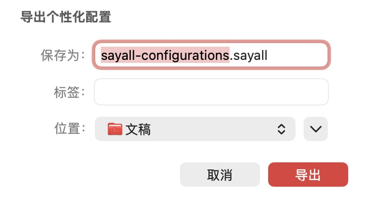
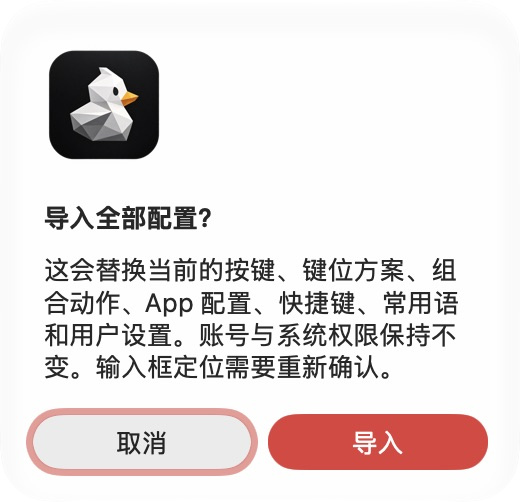

## 证据

用户提供的个人备份可通过原分享合同校验。
文件仅有一个无绑定方案和宿主设置，动作与 App 配置集合为空。
这只能证明文件结构可读，不能证明导出完整。
没有原导出时的完整存储快照，不能还原当时各库的内容。

## 确认的原因

设置页复用了分享导出图。
该图只收集当前方案和引用依赖，并裁剪未引用快捷键。
宿主设置只覆盖部分用户偏好，不包含全部设备配置。
Finder 请求只检查扩展名，统一送到键位方案导入。
原合同缺少生效的平台门禁和来源 Build。

隔离测试确认：分享导出会丢弃未引用快捷键。
同一存储通过完整归档导出后可保留该快捷键。

## 修复

宿主持有独立的 macOS 完整备份格式与读取器标识。
文件记录产品、平台、来源版本和 Build。
私有模块通过窄接口导出全部原生配置，不再按引用裁剪。
恢复保留对象 ID、版本、设备作用域、选择状态和 App 规则。
双击按文件内容分流。
完整备份进入设置页。

写入沿用事务校验、并发保护和失败回滚。

账号、授权、配对身份、历史和录音不迁移。
输入框指纹需要重新学习，脚本需要重新授权。
原始用户文件保持不变。文件内没有的数据不能凭空恢复。

## 验证与边界

- 公开宿主：`swift test --disable-keychain --scratch-path .build-public`。
- 私有三个模块分别执行 `swift test --disable-keychain`。
- 新回归覆盖全部设备、未引用 App、嵌套动作、全部版本、未引用快捷键、方案规则和常用语。
- 新回归覆盖平台与版本拒绝、非法写入位置拒绝和失败回滚。
- 2026-10-20：公开完整 909 项、统一私有二进制集成 918 项测试通过。
- 工程自测 48 项、市场合同 21 项和仓库治理检查通过。
- 带私有构件的 Release 构建通过。
- 原生设置页在隔离存储中成功导出、校验并恢复完整备份。
- 文件打开回归使用真实测试文件，覆盖挂载前后和重复请求。
- 新完整格式、旧个人备份和社区键位方案的内容分流均有回归。
- 正式签名安装包的系统 Finder 分发和跨 Mac 迁移仍待实测。

首次测试装配缺少私有资源 Bundle，导致运行失败。
补齐资源后，同一二进制测试通过。
默认旧构建目录还缓存了旧私有模块，导致自检附带构建失败。
本轮保留失败日志，用独立构建目录验证公开与私有构建。
自检单独运行 48 项，并复用已完成的隔离 Release 构建。
没有放宽业务测试或修改业务来掩盖装配问题。
- 本次不发布安装包。真实遥控器、第三方 App 和跨 Mac 迁移不在自动化证明范围内。

测试步骤见 [完整配置备份测试](../Testing/CompleteConfigurationBackup.md)。

## 文件与影响范围

| 文件组 | 修改原因 |
| --- | --- |
| `MacConfigurationBackup.swift` | 定义 macOS 完整备份和按内容分流。 |
| `AppSettings.swift` | 保存全部设备、App 配置、绑定和用户偏好。 |
| `MacroFeatureIntegration.swift` 与 `AppSettingsPortableTransfer.swift` | 设置备份改用完整归档。社区分享保留原接口。 |
| `MembershipFeatureIntegration.swift` | 通过私有接口备份常用语。 |
| `BridgeAppModel.swift` | 校验、恢复、回滚并刷新音频和按键设置。 |
| `SettingsView.swift` 与本地化资源 | 打开系统保存窗口，确认恢复并按内容选择入口。 |
| `Info.plist` | 更新文档显示名称，保留原类型标识和扩展名。 |
| 测试、自检列表、产品规范和测试手册 | 覆盖完整性、持久化、失败与兼容边界。 |

没有修改后端、会员权益或发布资产名称。
本次保留系统登录项注册和向导进度；它们不是可迁移验证证据。

## 页面证据

以下为生产设置页的隔离本地验证。
内部验证 App 只用于页面检查，不作为安装包分发。

| 文件 | 格式与尺寸 | SHA-256 |
| --- | --- | --- |
| `export-save-panel.jpg` | JPEG，728 × 408 | `b603047f93f69059ceabd7dbe708dc167dd633e474667eaabed0b659003529bd` |
| `import-confirm.jpg` | JPEG，520 × 502 | `d0f453cfbc988e77355b456a4459b82600d77289061368d4df84c6e6647778d3` |

## 最新主线补验

私有修复已通过 PR #245 合入。
标准 SwiftPM Tag 2.2.1 固定到该合并提交。
根包 Debug 完整测试和 Release 产品构建通过。
发布脚本测试模式问题由独立 PR #703 修复。

公开 PR #702 的首次 CI 在挂载后打开文件用例失败。
请求仍留在队列，没有被当前页面消费。
原入口依赖 SwiftUI 状态差异与首次页面刷新。
修复改用请求发布订阅，并在主循环接收已存储的请求。

无私有组件时直接处理，不等待不存在的导入观察器。
测试增加初次显示同一轮排入请求，保留重复打开检查。
没有延长测试超时，也没有删除成功条件。
本地首次时序实验未复现 CI 失败，保留这一验证边界。

私有二进制集成进一步确认导入预览没有打开。
请求已经传入私有页，但首次挂载前的请求没有被消费。
私有生产视图回归在原实现稳定失败。

私有 PR #247 改为订阅请求，修复后同一用例通过。
宿主文件打开四组场景及重复打开均通过。
该修复升级到 2.2.2；2.2.1 保持原位。

完整私有集成首次运行也触发发布 fixture 的环境差异。
发布控制测试按现行 CI 在公开模式单独验证。
私有完整测试不重复该公开发布 fixture。
所有失败日志保存在仓库外，没有删改断言。

#247 在独立目录的私有根包完整测试和 Release 构建通过。
根包测试保留两项既有跳过项。
复用旧目录曾报 Sentry 模块解析失败。
独立目录验证没有修改源码或降低测试条件。
